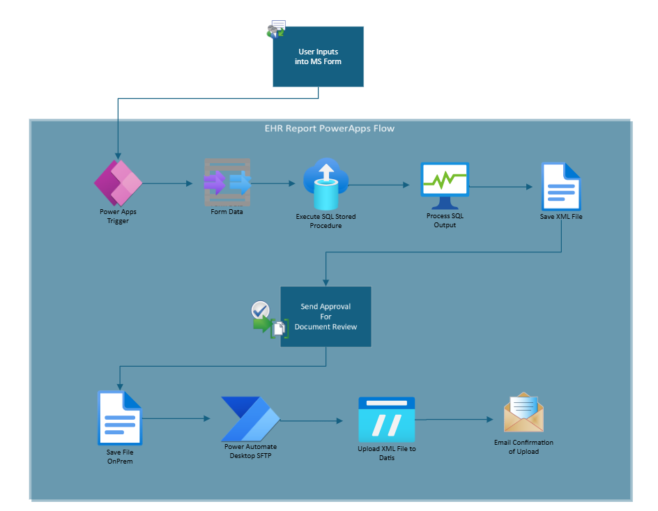

## Highlighted Projects

### 🔹 Finance Automation
**Payroll & Benefit Allocation**  
Designed and implemented a SQL Server-based payroll allocation system that distributes expenses across funding sources using employee service activity. Automated complex financial calculations, integrated Excel and Power Query reporting, and replaced a time-intensive manual process with repeatable, validated results.

[📖 Read the Engineering Case Study](https://github.com/safroese/engineering-playbook/tree/main/Case-Studies/Payroll-Allocation)

**EHR Payroll Data Upload**  
Developed an end-to-end payroll integration using SQL Server, T-SQL, XML generation, and Power Apps. Created a user-friendly workflow that generates vendor-compliant payroll files, with a review checkpoint before secure SFTP delivery through a Power Automate process developed in collaboration with Network Administration.

[📖 Read the Engineering Case Study](https://github.com/safroese/engineering-playbook/tree/main/Case-Studies/EHR-Payroll-XML-Upload)

  

  

  Click either image to view full size.

### 🔹 HR & Staff Systems
**HR Profile Change Alerts**  
Designed and implemented an automated HR change-detection system using SQL Server and Power Automate. The solution monitors personnel, certifications, licenses, registrations, and education records, consolidating meaningful changes into organized daily notifications and eliminating repetitive manual review.

[📖 Read the Engineering Case Study](https://github.com/safroese/engineering-playbook/tree/main/Case-Studies/HR-Daily-Changes)

**HR Software Migration**  
Rebuilt ETL pipelines and downstream reports following a major HR system change. Successfully transitioned to new data structures under tight deadlines.

**Organizational Charts Automation**  
Developed a semi-automated organizational chart maintenance system using SQL Server, Visio, and Power Automate. The solution uses location-based color coding to improve visual organization, compares current and previous employee records to identify staffing and organizational changes, and generates actionable update instructions through automated notifications. Significantly reduced manual review and maintenance of organizational charts covering 500+ employees.

### 🔹 Operational Applications

**Vehicle Reservation System**  
Designed and implemented a digital vehicle reservation system using Microsoft Forms and Power Automate. Replaced a paper-based process with a centralized workflow supporting staff across six counties, improving reservation coordination and reducing administrative overhead.

**Mileage Tracking App**  
Developed a digital mileage reporting solution to replace manual staff travel documentation. Streamlined mileage submissions, improved data security, and reduced administrative processing.

**Safety Incident Reporting**  
Developed and enhanced an automated safety incident reporting system using Microsoft Forms, SQL Server, and Power Automate. The solution captures incident information, routes notifications based on county, integrates supervisor lookup, and centralizes reporting data for HR review.

**Medicaid Redetermination App**  
Developed an ASP.NET application to track Medicaid eligibility and redetermination requirements. Implemented complex business rules and exceptions to accommodate changing eligibility policies during the COVID-19 public health emergency.

**Operational Productivity Dashboard**  
Modernized a legacy VBScript-based reporting process into a SQL Server and Power BI dashboard. Improved data accessibility, reporting usability, and maintainability while replacing outdated processing logic.

### 🔹 Infrastructure Projects
**SQL Server 2022 Migration**  
Led the migration from SQL Server 2019 to SQL Server 2022 hosted on an Azure virtual machine. Coordinated database migration, application connectivity, vendor ETL dependencies, and downstream reporting integrations while maintaining operational continuity. Modernized the database environment and established a foundation for improved performance, security, and ongoing administration.

**EHR Replica Security Upgrade**  
Enhanced the security of EHR data replication by implementing SSH key-based authentication and SQL Server connection encryption. Strengthened protection of sensitive data in transit, reduced reliance on password-based authentication, and improved the security of critical data integration processes.

---
